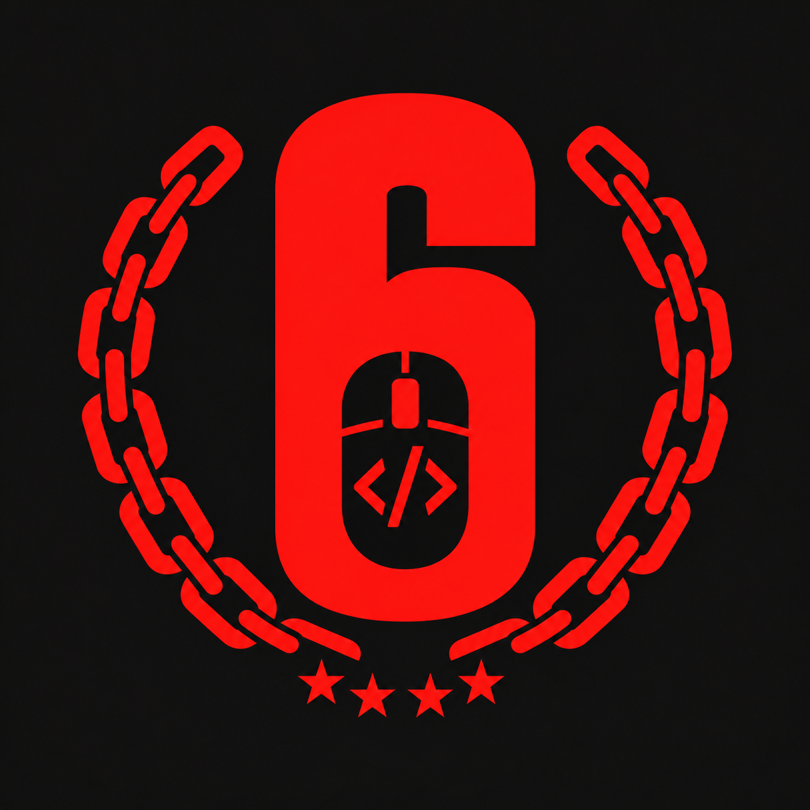

# Recoil-training-V1

Aplicativo experimental para Windows com perfis independentes e saída de mouse simulada ou real. Projeto independente, sem vínculo ou aprovação da Ubisoft. Não contém detecção de jogo nem contorno de anticheat. Macros podem contrariar regras de jogos; não há garantia contra punições.

**Recoil-training-V1** é o nome público do projeto no GitHub. O aplicativo
Windows continua se chamando **R6-Rebuild.exe**; o nome interno, as pastas de
configuração e todos os controles permanecem R6-Rebuild. Não renomeie o EXE
nem a pasta `_internal` para seguir o nome do repositório.

> **Publicação pendente:** esta é uma preparação local. A Release v1.0.0 e seu ZIP ainda não estão disponíveis. Consulte [os próximos passos](docs/PROXIMOS_PASSOS_PUBLICACAO.md). O novo candidato usa a logo com correntes no EXE; dependências, perfis e recursos históricos ainda têm pendências de revisão.

## Instalação

Após a liberação, o repositório `Recoil-training-V1` terá a Release
**Recoil-training-V1 v1.0.0**, com um ZIP para Windows contendo
`R6-Rebuild.exe`, `_internal` e os avisos de terceiros. O arquivo será
`Recoil-training-V1-v1.0.0-Windows-x64.zip`. Há um candidato local aguardando
aprovação; nenhum download público está disponível. Os links e o SHA-256
definitivo serão publicados somente depois da aprovação do pacote final.

1. Baixe o ZIP e escolha **Extrair tudo** no Windows. Não execute de dentro do ZIP.
2. Abra a pasta extraída e dê dois cliques em `R6-Rebuild.exe`.
3. Mantenha `_internal` ao lado do EXE. Para mover o aplicativo, copie a pasta inteira.
4. Não abra versões simultaneamente: atalhos globais podem se sobrepor e as configurações podem ser compartilhadas.

Requer Windows x64, Microsoft Edge WebView2 Runtime e .NET Framework compatíveis com o backend desktop. Python não é necessário na distribuição. Runtimes não são instalados automaticamente. O executável não tem assinatura digital; não desative proteções. A matriz completa de versões mínimas ainda precisa de homologação.

## Primeiros passos

O aplicativo inicia em **Simulação**, com **pausa geral ativada**. Comece nesse estado e confira o Diagnóstico. A simulação não emite movimentos físicos nem remove automaticamente pausas.

Escolha um dos 75 operadores e a arma primária ou secundária. Cada arma tem configuração independente. Os valores são observações documentadas em [Migração](docs/MIGRACAO.md), não ajustes garantidos para toda versão do jogo.

| Controle | Significado |
|---|---|
| X | Deslocamento horizontal por ciclo, decimal positivo ou negativo. A escolha original aplica X ou zero com probabilidade de 50% cada. |
| Y | Deslocamento vertical por ciclo. Positivo corresponde a movimento para baixo no Windows. |
| Speed | Intervalo em segundos: 0.020 = 20 ms; 0.100 = 100 ms. Menor intervalo solicita maior frequência. |
| Multiplicadores X/Y | Escalas aplicadas sem reescrever os valores-base armazenados. |
| Pausa individual | Bloqueia a arma correspondente independentemente da pausa geral. |

O motor acumula frações de forma exata e emite somente a parte inteira. O mínimo aceito é 0.001 s; isso não garante 1.000 ciclos/s. Não há fila para compensar ciclos atrasados.

## Modos, pausas e atalhos

| Comando | Ação |
|---|---|
| P | Alterna pausa geral ao soltar a tecla. |
| 1 / 2 | Seleciona arma primária / secundária. |
| F12 | Emergência: retorna à Simulação com pausa ativada. |
| L + R físicos | Ambos devem estar pressionados para emissão Real, além das demais condições de elegibilidade. |

Real exige confirmação explícita e começa pausado. Solte ambos os botões antes de retomar. Soltar L ou R impede novas emissões; uma chamada nativa já entregue ao Windows não pode ser cancelada retroativamente. As pausas individuais permanecem independentes.

O listener foi projetado para funcionar sem foco, inclusive minimizado. A compatibilidade em todas as combinações de dispositivos e aplicativos não está garantida. Não há bypass, injeção ou alteração de arquivos do jogo.

## Salvar e transferir configurações

As configurações são salvas em `%LOCALAPPDATA%\R6-Rebuild\settings.json`, com backup `settings.last-valid.json`. Use **Arquivos** para importar/exportar JSON. Exporte antes de grandes alterações ou troca de versão. Importação não restaura Real nem remove a pausa de segurança. Para outro computador, transfira uma exportação e importe no destino.

## Diagnóstico e solução de problemas

- **Não abre:** extraia o ZIP completo e confira `_internal`, Windows x64 e runtimes. Não baixe DLLs avulsas de sites desconhecidos.
- **Não movimenta em Simulação:** esperado; não existe saída física nesse modo.
- **Holding = SIM, mas bloqueado:** Holding indica L/R reconciliados, não elegibilidade. Confira pausas, arma habilitada e motivo do bloqueio.
- **L/R divergentes:** compare hook, leitura Windows, estado reconciliado e motor, com idades e sequências. Uma amostra positiva isolada não cria um pressionamento.
- **Real retorna à Simulação:** consulte o registro congelado da falha. Ele distingue listener, heartbeat e saída Windows, com idade, limite de 250 ms, atrasos, duração/retorno/erro da API e espera por locks. Não desative proteções ou aumente timeout para ocultar a falha.
- **Atalhos duplicados:** encerre outras instâncias.
- **Saída bloqueada em outro aplicativo:** permissões Windows/UIPI podem limitar a saída; não há garantia de aceitação por jogos/anticheat.

Para relatar falhas, informe versão, modo, parâmetros e diagnóstico sanitizado. Revise nomes, caminhos e configurações pessoais antes de compartilhar.

## Limitações e licenças

Não há garantia de tempo real rígido, compatibilidade com jogos ou equivalência completa com o programa observado. Miras ilustrativas não são um overlay global. A versão do código permanece 0.5.0; v1.0.0 é a futura Release pretendida.

A MIT da raiz aplica-se somente ao código e documentação próprios, conforme [LICENCIAMENTO](docs/LICENCIAMENTO.md). Recursos, marcas, perfis e dependências não são automaticamente relicenciados.

A imagem com correntes foi fornecida pelo responsável para apresentação pública e também é o ícone do candidato Windows. A arte antiga e os relatórios internos foram excluídos do histórico preparado para publicação, mantendo backups locais privados. A mudança visual não certifica direitos sobre a nova imagem, os perfis ou outros recursos.

Os avisos reunidos estão em [THIRD_PARTY_NOTICES.txt](THIRD_PARTY_NOTICES.txt) e `licenses/`. Leia as pendências antes de redistribuir.

## Código-fonte e desenvolvimento

O código Python fica em `src/r6_rebuild`, a interface em `frontend`, os perfis
em `data` e os testes em `tests`. Para desenvolver, crie uma `.venv` com Python
3.13 e instale `requirements-build.txt` somente após revisar as dependências.
Execute `python -m unittest discover -s tests` e `npm test` (Node necessário
apenas para testes JavaScript). Para os testes de ponte, configure
`R6_TEST_PYTHON` com o caminho do Python dessa `.venv`.

`tools/build_windows.py` cria distribuições separadas e exige a `.venv` local;
consulte `--help` para destinos de build e relatório. Artefatos em `build/`,
`dist/` e `publication-private/` nunca devem ser enviados ao repositório.
O checklist de publicação está em [Próximos passos](docs/PROXIMOS_PASSOS_PUBLICACAO.md).
